# Guia de col·laboració amb Git

Aquesta guia descriu el flux recomanat per treballar en el repositori amb Git. Està pensada per a un equip de persones i per reduir conflictes i errors accidentals.

note:
- [Guia de col·laboració amb Git](#guia-de-collaboració-amb-git)
  - [Regles bàsiques](#regles-bàsiques)
  - [Configuració inicial](#configuració-inicial)
  - [Flux de treball recomanat](#flux-de-treball-recomanat)
    - [1. Actualitzar `main`](#1-actualitzar-main)
    - [2. Crear una branca](#2-crear-una-branca)
    - [3. Revisar els canvis](#3-revisar-els-canvis)
    - [4. Fer un commit](#4-fer-un-commit)
    - [5. Pujar la branca](#5-pujar-la-branca)
    - [6. Crear una Pull Request](#6-crear-una-pull-request)
  - [Integrar i publicar els canvis](#integrar-i-publicar-els-canvis)
    - [Qui fa cada acció?](#qui-fa-cada-acció)
    - [Merge des de la línia d’ordres](#merge-des-de-la-línia-dordres)
  - [Abans d’aprovar o fer merge](#abans-daprovar-o-fer-merge)
  - [Si hi ha conflictes](#si-hi-ha-conflictes)
  - [Errors habituals](#errors-habituals)
    - [He modificat `main` localment sense voler](#he-modificat-main-localment-sense-voler)
    - [He fet un commit, però encara no l’he pujat](#he-fet-un-commit-però-encara-no-lhe-pujat)
    - [He fet `push` d’un fitxer sensible](#he-fet-push-dun-fitxer-sensible)
  - [Comandes de consulta segura](#comandes-de-consulta-segura)
  - [Resum ràpid](#resum-ràpid)


---

## Regles bàsiques

- No feu `push` directament a `main`.
- Cada canvi important es fa en una branca pròpia i es proposa mitjançant una Pull Request.
- Abans de començar, actualitzeu sempre la còpia local.
- Feu commits petits, relacionats amb una sola tasca.
- No pugeu contrasenyes, claus, certificats privats ni fitxers temporals.
- No modifiqueu el treball d’una altra persona sense parlar-ho abans.

---

## Configuració inicial

Només cal fer-ho una vegada:

```bash
git config --global user.name "El vostre nom"
git config --global user.email "el.vostre.email@example.com"
git clone URL_DEL_REPOSITORI
cd REPOSITORI
```

Utilitzeu una clau SSH o un gestor de credencials. No escriviu contrasenyes dins de les ordres ni dels fitxers del projecte.

---

## Flux de treball recomanat

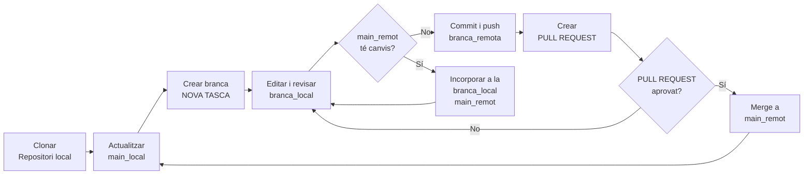
* Existeix un repositori en remot GitHub i un repositori en local.
* Els dos repositoris poden contenir tot l'historia de canvis, commits i branques.
* És responsabilitat de l'usuari mantenir les actualitzacions.

---


### 1. Actualitzar `main`
</br>

Abans de crear una branca:

```bash
git switch main
git pull --ff-only origin main
```

Si `git pull --ff-only` dona un error, no forceu l’operació. Demaneu ajuda abans de continuar.

---v

A **VS code** s'ha de vigilar que la branca **main** no tingui sincronitzacions pendents.

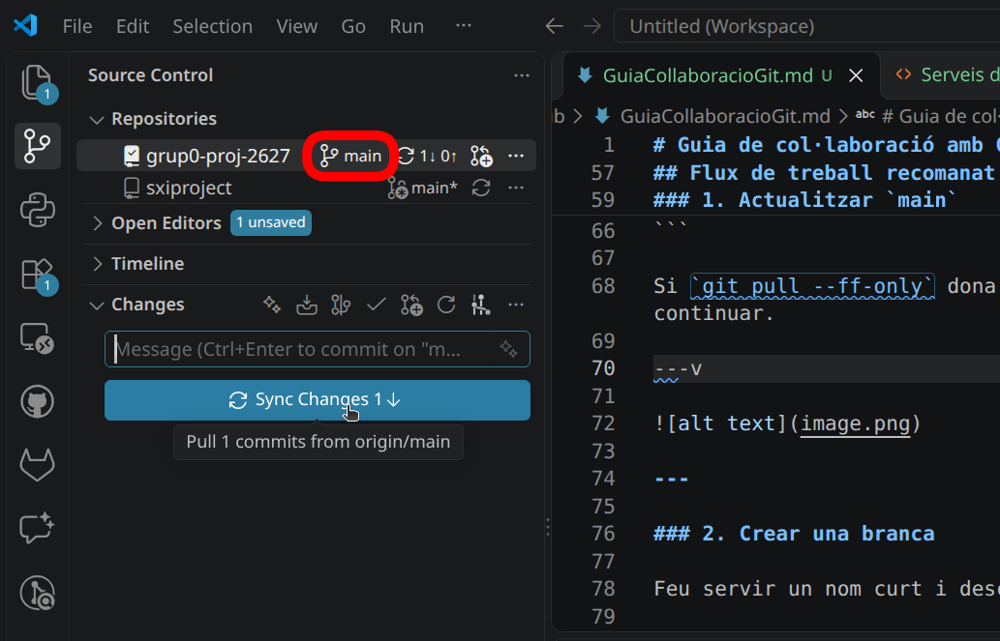

---

### 2. Crear una branca

Feu servir un nom curt i descriptiu:

```bash
git switch -c docs/grup-03-dns
```

Formats recomanats:

- `docs/descripcio` per a documentació.
- `fix/descripcio` per corregir un error.
- `feat/descripcio` per afegir contingut o funcionalitat.

---v

A ***VS code*** s'ha de vigilar de crear la branca a partir de **main**.

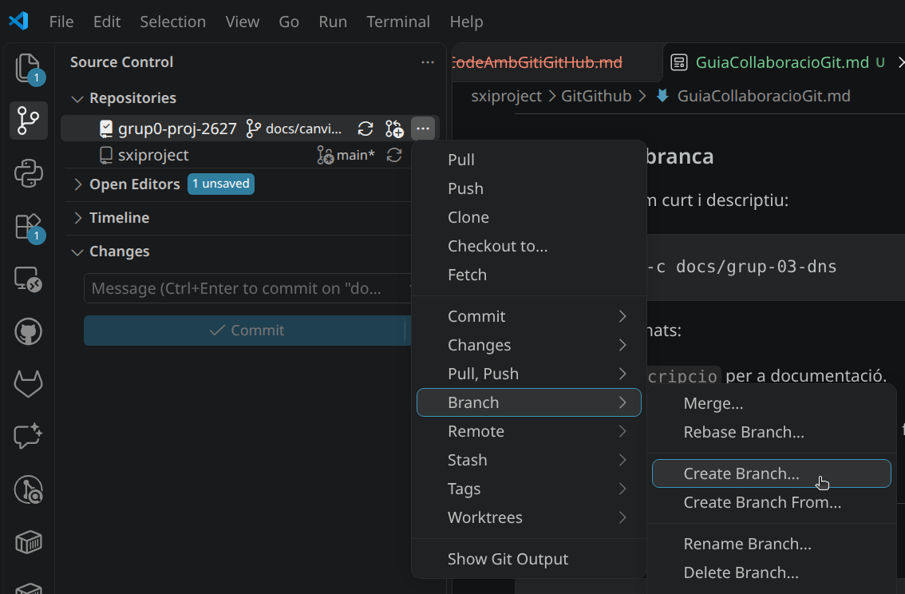

---

### 3. Revisar els canvis

```bash
git status
git diff
```

Comproveu que només hi hagi els fitxers que realment voleu modificar.

---v

A ***VS code*** s'ha de revisar que **Changes** hi hagi els fitxers que s'han modificat
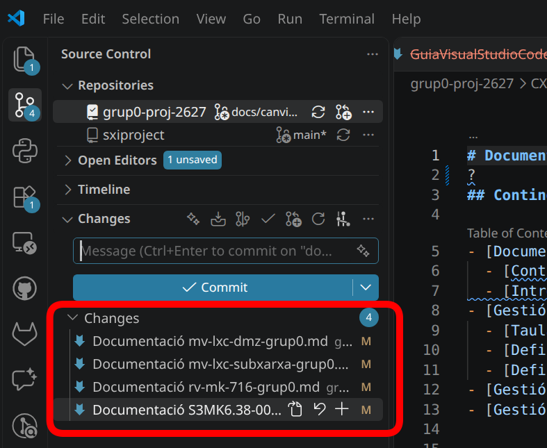

---

### 4. Fer un commit

```bash
git add fitxer.md
git commit -m "docs: actualitza la documentació del grup 3"
```

Un bon missatge explica l’acció realitzada. Exemples:

- `docs: afegeix la configuració DNS`.
- `docs: corregeix els enllaços del grup 5`.
- `fix: corregeix el nom d’un fitxer`.

---v

És important abans de fer el commit vigilar que no hi hagi sincronitzacions pendents. Comprovar quins són els fitxers i carpetes que es volen canviar. 
Al final simplement posar un bon missatge, vigilar la branca activa i pitjar el botó de **Commit**.
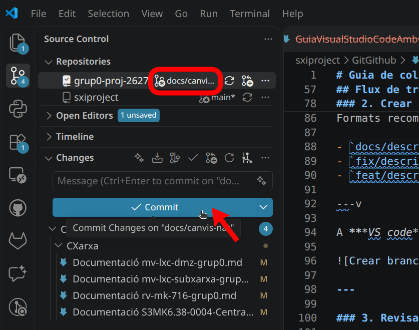

---v

Abans de fer el commit una bona política seria agafar els possibles canvis recents del main i incorporar-los a la branca.

```bash
git switch main
git pull --ff-only origin main
```
A **VS Code** simplement s'ha de fer un **pull from**
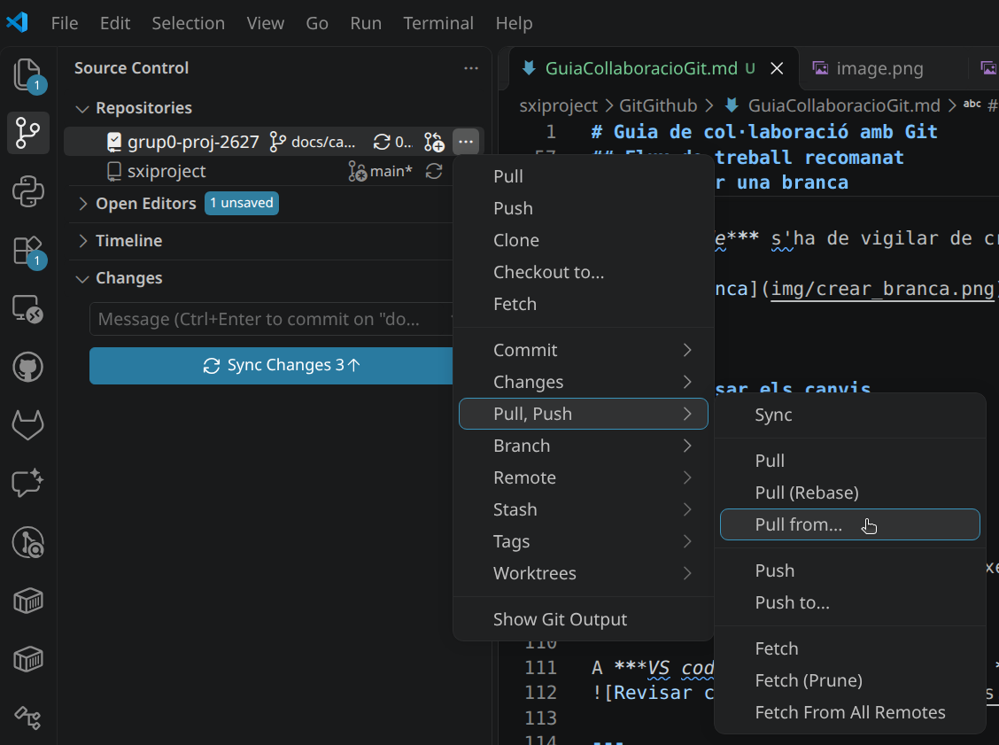

---

### 5. Pujar la branca
</br>

```bash
git push -u origin docs/grup-03-dns
```

La primera ordre associa la branca local amb la remota. 

En les actualitzacions següents normalment n’hi ha prou amb:

```bash
git push
```

---v

A ***VS code*** s'ha de revisar de fer el push a la branca adeauada

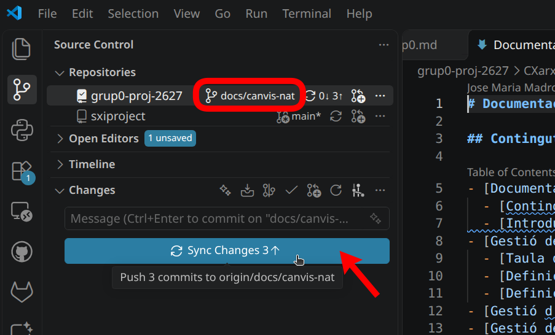

---

### 6. Crear una Pull Request

A la plataforma del repositori a **GitHub**:

1. Creeu una Pull Request des de la vostra branca cap a `main`.
2. Poseu un títol clar i breu.
3. Expliqueu què heu canviat i, si cal, com ho heu comprovat.
4. Relacioneu la tasca o incidència corresponent.
5. Demaneu revisió a una altra persona.
6. Espereu l’aprovació i les comprovacions automàtiques abans de fer el merge.

No feu merge de la vostra pròpia Pull Request si el projecte exigeix revisió d’una altra persona.

---v

S'ha de fer el **New Pull Request**

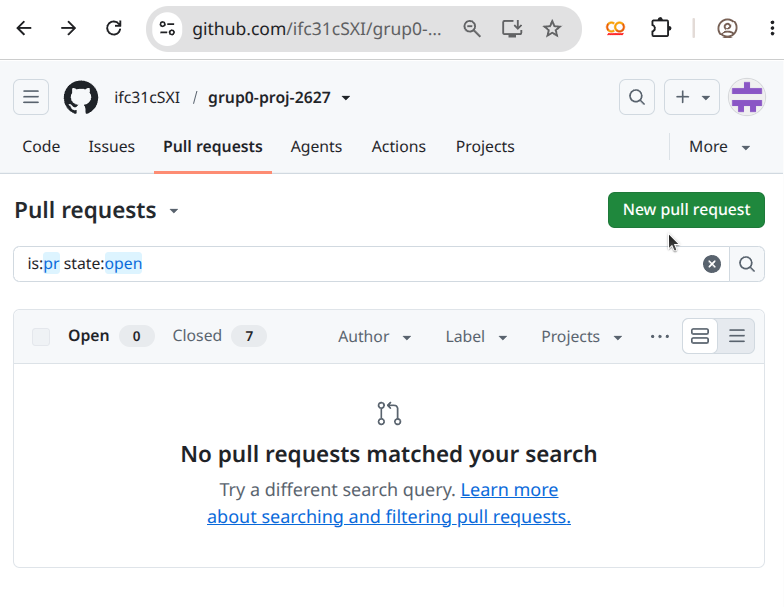

---v

S'ha de fer el **Pull Request** de la branca desitjada

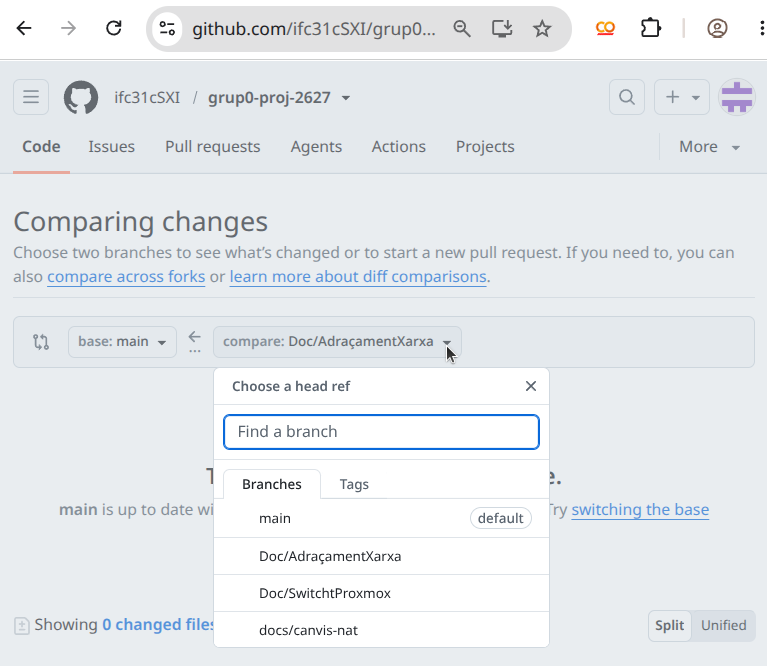

Al final s'han de seguir les instruccions per poder integrar els canvis.

---

## Integrar i publicar els canvis

La Pull Request no modifica `main` immediatament. El circuit és:

```text
branca local -> push -> branca remota -> Pull Request -> revisió -> merge -> main remot
```

Quan la revisió és aprovada, la persona responsable fa clic a **Merge** o
**Merge pull request** a la plataforma Git. Aquesta acció integra els commits
de la branca dins de `main` i publica el resultat al repositori remot.

Després del merge, cada col·laborador actualitza la seva còpia local:

```bash
git switch main
git pull --ff-only origin main
```

Els canvis integrats ja són visibles per a tothom que actualitzi el repositori.
No cal fer un segon `push` a `main`: el merge de la Pull Request ja ha publicat
els canvis al repositori remot.

---

### Qui fa cada acció?

| Acció | Persona responsable |
|---|---|
| Editar, fer `commit` i fer `push` de la branca | Persona que fa la tasca |
| Revisar la Pull Request | Una altra persona de l’equip |
| Fer el merge a `main` | Responsable autoritzat del repositori |
| Actualitzar la còpia local | Cada col·laborador |

---

### Merge des de la línia d’ordres

Només ho ha de fer una persona autoritzada i quan la Pull Request ja estigui
aprovada:

```bash
git switch main
git pull --ff-only origin main
git merge --no-ff origin/docs/grup-03-dns -m "merge: integra la documentació del grup 3"
git push origin main
```

En un equip amb poca experiència és preferible fer el merge amb el botó de la
Pull Request, perquè la plataforma mostra les aprovacions, els conflictes i les
comprovacions abans de publicar el canvi.

---v

Una vegada s'ha pujat la branca i seleccionat de quina branca es vol fer el pull request s'ha de crear 
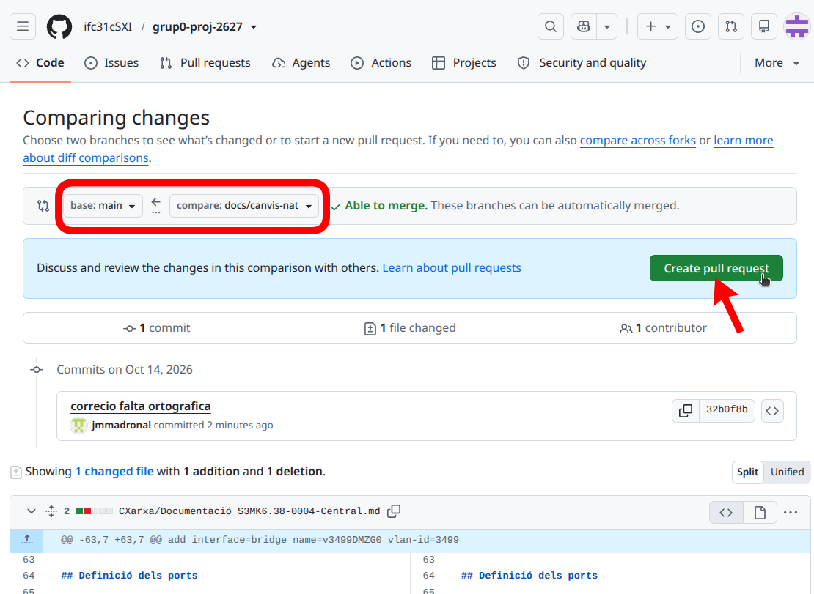

---v

Una vegada resolt els conflictes es fa el **Merge pull request**
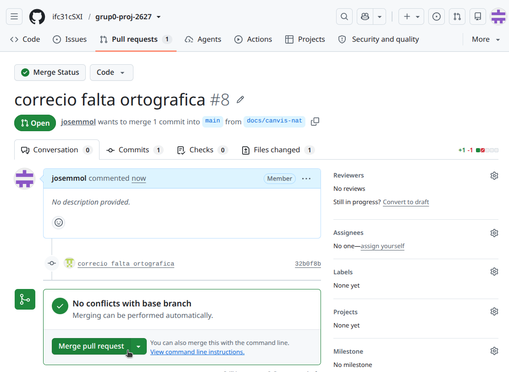

---

## Abans d’aprovar o fer merge

La persona revisora ha de comprovar:

- que el contingut és correcte i entenedor;
- que els enllaços funcionen;
- que no s’han modificat fitxers aliens a la tasca;
- que no hi ha credencials ni dades privades;
- que la Pull Request és fàcil de revisar.

Es recomana activar a `main`:

- protecció de la branca;
- Pull Request obligatòria;
- almenys una aprovació;
- comprovacions automàtiques obligatòries;
- bloqueig del `push` directe;
- bloqueig del `force push`.

---

## Si hi ha conflictes

No esborreu canvis per resoldre un conflicte. Feu el següent:

```bash
git fetch origin
git switch la-vostra-branca
git merge origin/main
```

Obriu els fitxers indicats per Git i conserveu la versió correcta. Després:

```bash
git add fitxer-resolt.md
git commit -m "merge: resol conflictes amb main"
git push
```

Si no sabeu quina versió conservar, atureu-vos i demaneu revisió a la persona responsable del fitxer.

---

## Errors habituals

### He modificat `main` localment sense voler

No feu `push`. Deseu els canvis en una branca:

```bash
git switch -c docs/canvis-recuperats
git add .
git commit -m "docs: recupera canvis locals"
git push -u origin docs/canvis-recuperats
```

---

### He fet un commit, però encara no l’he pujat

Reviseu-lo i pugeu-lo:

```bash
git show --stat
git push
```

---

### He fet `push` d’un fitxer sensible

No el considereu resolt només esborrant-lo en un commit posterior. Aviseu immediatament la persona responsable, revoqueu o canvieu la credencial exposada i elimineu-la de l’historial amb ajuda experta.

---

## Comandes de consulta segura

```bash
git status                 # estat dels fitxers
git branch                 # branques locals
git log --oneline -5       # darrers commits
git diff                   # canvis encara no preparats
git diff --staged          # canvis preparats per al commit
```

---

## Resum ràpid

```bash
git switch main
git pull --ff-only origin main
git switch -c docs/la-meva-tasca
# editar fitxers
git status
git add fitxer.md
git commit -m "docs: descriu el canvi"
git push -u origin docs/la-meva-tasca
# crear Pull Request i esperar la revisió
```
