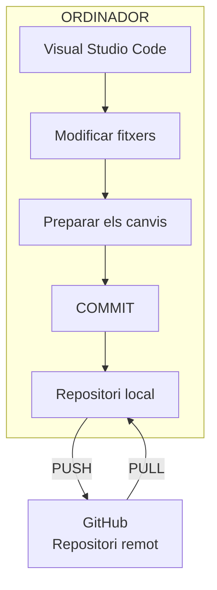
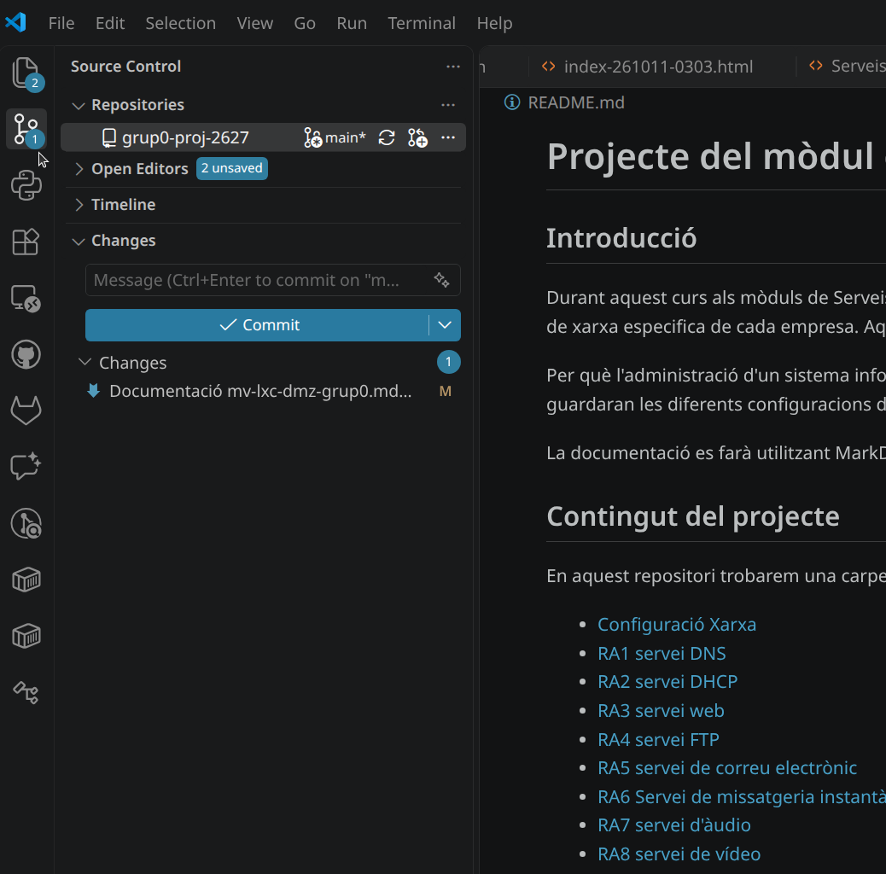

# Guia pràctica de Visual Studio Code amb Git i GitHub

Aquesta guia explica com configurar **Visual Studio Code (VS Code) a Windows** per treballar amb repositoris de GitHub i fer les operacions habituals de control de versions: clonar repositoris, modificar fitxers, fer commits, crear branques, executar push i pull, fusionar branques (*merge*) i resoldre conflictes.

La idea és que puguis utilitzar-la com a manual de consulta quan treballis en els teus projectes.

Note:
## 0. Continguts
- [Guia pràctica de Visual Studio Code amb Git i GitHub](#guia-pràctica-de-visual-studio-code-amb-git-i-github)
  - [0. Continguts](#0-continguts)
  - [1. Entendre les eines que utilitzarem](#1-entendre-les-eines-que-utilitzarem)
    - [Un exemple visual del flux de treball](#un-exemple-visual-del-flux-de-treball)
  - [2. Configurar l'entornamb Visual Studio Code](#2-configurar-lentornamb-visual-studio-code)
    - [2.1.1. Instal·lar i configurar Git](#211-installar-i-configurar-git)
      - [Instal·lar Git a linux](#installar-git-a-linux)
      - [Descarregar instal·lar Git a Windows](#descarregar-installar-git-a-windows)
      - [Comprovar la instal·lació](#comprovar-la-installació)
      - [Configurar el nom i el correu electrònic](#configurar-el-nom-i-el-correu-electrònic)
      - [Comprova la configuració amb:](#comprova-la-configuració-amb)
    - [2.2. Preparar VS Code i connectar-lo amb GitHub](#22-preparar-vs-code-i-connectar-lo-amb-github)
      - [Obrir VS Code](#obrir-vs-code)
      - [Localitzar les funcions de Git](#localitzar-les-funcions-de-git)
      - [Executar ordres amb Git](#executar-ordres-amb-git)
      - [Iniciar sessió a GitHub](#iniciar-sessió-a-github)
  - [3. Clonar un repositori de GitHub](#3-clonar-un-repositori-de-github)
      - [Pas 1. Copiar l'adreça del repositori](#pas-1-copiar-ladreça-del-repositori)
      - [Pas 2. Clonar-lo des de VS Code](#pas-2-clonar-lo-des-de-vs-code)
      - [Pas 3. Comprovar que el repositori està preparat](#pas-3-comprovar-que-el-repositori-està-preparat)
  - [4. Entendre el panell de control de versions](#4-entendre-el-panell-de-control-de-versions)
    - [Les parts principals](#les-parts-principals)
    - [Com funcionen els canvis?](#com-funcionen-els-canvis)
  - [5. Fer el primer commit](#5-fer-el-primer-commit)
    - [Passos per fer el commit](#passos-per-fer-el-commit)
    - [Com han de ser els missatges dels commits?](#com-han-de-ser-els-missatges-dels-commits)
    - [Alternativa: fer el commit des del terminal](#alternativa-fer-el-commit-des-del-terminal)
  - [6. Consultar l'estat i l'historial del repositori](#6-consultar-lestat-i-lhistorial-del-repositori)
    - [6.1. Consultar l'estat](#61-consultar-lestat)
    - [6.2. Consultar l'historial](#62-consultar-lhistorial)
    - [6.3. Veure les diferències](#63-veure-les-diferències)
  - [7. Treballar amb branques (*branches*)](#7-treballar-amb-branques-branches)
    - [7.1. Veure la branca actual](#71-veure-la-branca-actual)
    - [7.2. Crear una branca nova des de VS Code](#72-crear-una-branca-nova-des-de-vs-code)
    - [7.3. Crear una branca des del terminal](#73-crear-una-branca-des-del-terminal)
    - [7.4. Treballar a la branca nova](#74-treballar-a-la-branca-nova)
    - [7.5. Canviar de branca](#75-canviar-de-branca)
    - [7.6. Quan convé crear branques?](#76-quan-convé-crear-branques)
  - [8. Fer un push: enviar els canvis a GitHub](#8-fer-un-push-enviar-els-canvis-a-github)
    - [8.1. Fer push des de VS Code](#81-fer-push-des-de-vs-code)
    - [8.2. Fer push des del terminal](#82-fer-push-des-del-terminal)
    - [8.3. Comprovar que ha funcionat](#83-comprovar-que-ha-funcionat)
  - [9. Fer un pull: actualitzar el repositori local](#9-fer-un-pull-actualitzar-el-repositori-local)
    - [9.1. Fer pull des de VS Code](#91-fer-pull-des-de-vs-code)
    - [9.2. Fer pull des del terminal](#92-fer-pull-des-del-terminal)
    - [9.3. Què passa si tens canvis locals?](#93-què-passa-si-tens-canvis-locals)
    - [9.4. Diferència entre fetch i pull](#94-diferència-entre-fetch-i-pull)
  - [10. Fer un merge: fusionar dues branques](#10-fer-un-merge-fusionar-dues-branques)
    - [10.1. Entendre el procés](#101-entendre-el-procés)
    - [10.2. Preparar la fusió](#102-preparar-la-fusió)
    - [10.3. Fer merge des de VS Code](#103-fer-merge-des-de-vs-code)
    - [10.4. Fer merge des del terminal](#104-fer-merge-des-del-terminal)
    - [10.5. El merge també es pot fer a GitHub](#105-el-merge-també-es-pot-fer-a-github)
  - [11. Resoldre conflictes de merge](#11-resoldre-conflictes-de-merge)
    - [11.1. Com identificar un conflicte](#111-com-identificar-un-conflicte)
    - [11.2. Resoldre el conflicte des de VS Code](#112-resoldre-el-conflicte-des-de-vs-code)
    - [11.3. Completar la resolució](#113-completar-la-resolució)
    - [11.4. I si vull cancel·lar el merge?](#114-i-si-vull-cancellar-el-merge)
  - [12. El flux de treball complet recomanat](#12-el-flux-de-treball-complet-recomanat)
    - [Fase 1. Començar a treballar](#fase-1-començar-a-treballar)
    - [Fase 2. Desenvolupar la funcionalitat](#fase-2-desenvolupar-la-funcionalitat)
    - [Fase 3. Publicar la branca](#fase-3-publicar-la-branca)
    - [Fase 4. Incorporar els canvis a main](#fase-4-incorporar-els-canvis-a-main)
    - [Fase 5. Continuar treballant](#fase-5-continuar-treballant)
  - [13. Taula de referència ràpida: ordres Git](#13-taula-de-referència-ràpida-ordres-git)
  - [14. Problemes habituals i solucions](#14-problemes-habituals-i-solucions)
    - [Una precaució important](#una-precaució-important)
  - [15. Recomanacions de seguretat i bones pràctiques](#15-recomanacions-de-seguretat-i-bones-pràctiques)
  - [16. Documentació oficial per continuar aprenent](#16-documentació-oficial-per-continuar-aprenent)
    - [Resum: què hauries de recordar?](#resum-què-hauries-de-recordar)

---

## 1. Entendre les eines que utilitzarem

Abans de començar, és important distingir tres elements:

| Eina                   | Per a què serveix?                                            |
| ---------------------- | ------------------------------------------------------------- |
| **Visual Studio Code** | Editor on escrius i modifiques el codi.                       |
| **Git**                | Sistema que registra els canvis del projecte i permet treballar amb versions i branques. |
| **GitHub**             | Servei en línia on allotges els repositoris i comparteixes els canvis.   |

El funcionament general és aquest:

* Treballes amb els fitxers del projecte a VS Code.
* Git registra els canvis a l'ordinador.
* GitHub emmagatzema una còpia remota del repositori.
* Amb `push` envies els teus commits a GitHub.
* Amb `pull` incorpores els canvis publicats a GitHub al teu repositori local.

---

### Un exemple visual del flux de treball



note:
**Una idea fonamental:** fer un commit no publica els canvis a GitHub. Per publicar-los, normalment hauràs de fer un `push`. 

---

## 2. Configurar l'entornamb Visual Studio Code
</br>
2.1. Instal·lar i configurar Git  
</br></br></br>
2.2. Preparar VS Code i connectar-lo amb GitHub  

---

### 2.1.1. Instal·lar i configurar Git 

Si ja tens Git instal·lat, pots passar directament a l'apartat 2.2.
</br></br>
#### Instal·lar Git a linux
Entrar al terminal:
```
sudo apt update
sudo apt install git
```

---

#### Descarregar instal·lar Git a Windows

1. Obre la pàgina oficial: [https://git-scm.com/downloads/win](https://git-scm.com/downloads/win)
2. Descarrega Git for Windows.
3. Executa l'instal·lador.
4. Durant la instal·lació, pots mantenir les opcions predeterminades si no tens necessitats especials.
5. Completa la instal·lació.

Git for Windows inclou Git i Git Bash. També permet utilitzar Git des del terminal de VS Code.

---

#### Comprovar la instal·lació
</br>

Obre **VS Code**.

</br></br>
Al menú superior, selecciona:

**Terminal → New Terminal**

S'obrirà un terminal a la part inferior de la finestra.

Escriu:

```bash
git --version
```

Si tot funciona correctament, apareixerà una resposta semblant a `

```text
git version 2.51.0.windows.1
```

note:
La versió exacta pot ser diferent.

Si apareix un missatge que indica que `git` no es reconeix com una ordre, comprova que Git està instal·lat i disponible al `PATH`. Si acabes d'instal·lar-lo, tanca i torna a obrir VS Code.

---

#### Configurar el nom i el correu electrònic

Git necessita identificar l'autor dels commits.

Al terminal, executa:

```bash
git config --global user.name "El teu nom"
```

Després:

```bash
git config --global user.email "el_teu_correu@example.com"
```

Substitueix els valors d'exemple per les teves dades.

Si vols que els commits apareguin associats al teu compte de GitHub, utilitza una adreça de correu electrònic associada a aquest compte o l'adreça privada que GitHub et proporciona.

---

#### Comprova la configuració amb:

```bash
git config --global --list
```

Hauries de veure, entre altres dades:

```text
user.name=El teu nom
user.email=el_teu_correu@example.com
```
Preparar VS Code i connectar-lo amb GitHub
Aquesta configuració es fa una sola vegada per cada entorn d'usuari, no per cada projecte.

---

### 2.2. Preparar VS Code i connectar-lo amb GitHub
</br>

#### Obrir VS Code

Pots descarregar VS Code des de la pàgina oficial:

[https://code.visualstudio.com/](https://code.visualstudio.com/)

Si ja el tens instal·lat, obre'l normalment.

---

#### Localitzar les funcions de Git

A VS Code, la icona de **Control de codi font** (*Source Control*) es troba a la barra d'activitats de l'esquerra. Té una icona semblant a una branca amb punts connectats.



També pots obrir aquest panell amb la drecera:

**`Ctrl + Shift + G`**

Des d'aquí podràs veure els fitxers modificats, preparar els canvis i crear commits.

---

#### Executar ordres amb Git
</br>

Per executar ordres de Git des de la paleta d'ordres, prem:

**`Ctrl + Shift + P`**

Després escriu l'ordre que necessitis, com ara `Git: Clone`.

---

#### Iniciar sessió a GitHub
</br>

Per als repositoris privats o per a determinades funcions d'integració, necessitaràs autenticar-te.

Pots fer-ho mitjançant el navegador quan VS Code o Git et demanin accés. També pots instal·lar l'extensió oficial **GitHub Pull Requests**, si vols gestionar pull requests i incidències des de VS Code.

No necessites aquesta extensió per fer les operacions bàsiques de Git.

**Important:** iniciar sessió a l'extensió de GitHub i autenticar Git per fer `push` són operacions relacionades, però no sempre equivalen a la mateixa sessió. Si Git et demana autenticació, segueix el procediment que et mostri.

---

## 3. Clonar un repositori de GitHub

**Clonar** significa descarregar una còpia del repositori a l'ordinador, incloent-hi els fitxers i l'historial de versions.

#### Pas 1. Copiar l'adreça del repositori

1. Entra a [GitHub](https://github.com/).
2. Obre el repositori que vols utilitzar.
3. Prem el botó **Code**.
4. Selecciona **HTTPS**.
5. Copia l'adreça. Per exemple:

```text
https://github.com/usuari/projecte.git
```
note:
Aquesta adreça és un exemple: hauràs d'utilitzar la del teu repositori.

---

#### Pas 2. Clonar-lo des de VS Code

1. Obre VS Code.
2. Prem `Ctrl + Shift + P` per obrir la paleta d'ordres.
3. Escriu:

```text
Git: Clone
```

4. Selecciona l'ordre **Git: Clone**.
5. Enganxa l'adreça del repositori.
6. Prem `Enter`.
7. Selecciona la carpeta on vols guardar els projectes. Per exemple:

```text
C:\Users\ElTeuUsuari\Documents\GitHub
```

8. Espera que es descarregui el repositori.
9. Quan VS Code t'ofereixi obrir-lo, selecciona **Open**.

note:
Si és la primera vegada que obres el projecte, pot aparèixer una pregunta sobre si confies en els fitxers. Només confirma-ho si coneixes i confies en l'origen del projecte.

---

#### Pas 3. Comprovar que el repositori està preparat

Obre el terminal integrat de VS Code amb **Terminal → New Terminal** i executa:

```bash
git status
```

Una resposta possible és:

```text
On branch main
Your branch is up to date with 'origin/main'.

nothing to commit, working tree clean
```

Això indica que ets a la branca `main` i que no tens canvis locals pendents.

Els noms de les branques i el missatge exacte poden variar.

**Què has de recordar?** Normalment, només has de clonar un repositori una vegada a cada ordinador. Després, obres la carpeta local i continues treballant-hi.

[Documentació oficial: clonar repositoris a GitHub](https://docs.github.com/en/repositories/creating-and-managing-repositories/cloning-a-repository).

---

## 4. Entendre el panell de control de versions

Una vegada obert el projecte, prem:

`Ctrl + Shift + G`

Apareixerà el panell **Control de codi font (Source Control)**.

Aquest és un dels espais que utilitzaràs més sovint.

---

### Les parts principals

**1. Changes (Canvis)**

Mostra els fitxers que has modificat, creat o eliminat i que Git encara no ha inclòs a l'àrea de preparació (*staging area*).

**2. Staged Changes (Canvis preparats)**

Mostra els canvis que has seleccionat expressament per incloure en el pròxim commit.

**3. Message (Missatge)**

És el camp on escrius una descripció del commit.

**4. Commit**

Registra els canvis preparats a l'historial local de Git.


**5. More Actions (`...`)**

Obre un menú amb altres operacions, que poden incloure opcions de fetch, pull, push, branques i altres accions de Git.

La disposició exacta de les opcions pot variar segons la versió de VS Code.

---

### Com funcionen els canvis?

Imagina que modifiques un fitxer anomenat `programa.py`.

Git detecta la modificació i la mostra a **Changes**.

Quan selecciones el signe `+` al costat del fitxer, el mous a **Staged Changes**.

A continuació, escrius un missatge i fas el commit.

El procés és:

```text
Modificar el fitxer
        ↓
     Changes
        ↓
    Stage (+)
        ↓
  Staged Changes
        ↓
      Commit
        ↓
Historial local de Git
```

No és obligatori preparar tots els fitxers modificats alhora. Pots seleccionar només els que vols incloure en un commit concret.

[Documentació oficial: control de versions a VS Code](https://code.visualstudio.com/docs/sourcecontrol/overview).

---

## 5. Fer el primer commit

Un **commit** és una instantània dels canvis que decideixes registrar a l'historial del repositori.

Imagina que modifiques el fitxer `README.md` i hi afegeixes una línia:

```markdown
# El meu projecte

Primera versió del projecte.
```
Desa el fitxer amb `Ctrl + S`.

---

### Passos per fer el commit

**Pas 1.** Obre el panell de control de versions amb `Ctrl + Shift + G`.

**Pas 2.** Revisa els fitxers que apareixen a `Changes`.

**Pas 3.** Fes clic en un fitxer per examinar-ne les diferències.

**Pas 4.** Prem el signe `+` del fitxer que vols incloure al commit.

Si vols preparar tots els canvis, pots utilitzar l'opció de preparar-los tots, si apareix a la interfície.

**Pas 5.** Escriu un missatge de commit. Per exemple:

```text
Afegir descripció inicial del projecte
```

**Pas 6.** Prem **Commit**.

Si VS Code t'indica que no hi ha canvis preparats, comprova que has fet el *stage* dels fitxers.

---

### Com han de ser els missatges dels commits?

És recomanable que siguin breus i descriptius.

| Missatge recomanat                     | Què descriu?                        |
| -------------------------------------- | ----------------------------------- |
| `Afegir validació del formulari`       | Una nova funcionalitat.             |
| `Corregir error en el càlcul del preu` | Una correcció.                      |
| `Actualitzar documentació`             | Una modificació de la documentació. |
| `Eliminar funció obsoleta`             | Una eliminació.                     |

Evita missatges genèrics com `Canvis`, `Prova` o `Actualització`, perquè no expliquen què has fet.

---

### Alternativa: fer el commit des del terminal

També pots executar les operacions amb ordres Git.

Per preparar un fitxer concret:

```bash
git add README.md
```

Per preparar tots els canvis detectats al directori actual i als seus subdirectoris:

```bash
git add .
```

Per registrar els canvis preparats:

```bash
git commit -m "Afegir descripció inicial del projecte"
```

Les operacions realitzades des del terminal i des de la interfície gràfica actuen sobre el mateix repositori.

**Atenció:** `git add .` pot incloure més fitxers dels que vols. Abans de fer el commit, revisa sempre què has preparat.

---

## 6. Consultar l'estat i l'historial del repositori
</br>

Hi ha tres operacions molt útils per saber què està passant al repositori.

---


### 6.1. Consultar l'estat

```bash
git status
```

Aquesta ordre indica:

* La branca activa.
* Els fitxers modificats.
* Els fitxers preparats per al pròxim commit.
* Els commits pendents de publicar.
* Si hi ha canvis pendents d'integrar.

És una de les ordres més útils quan no saps en quin punt et trobes.

---

### 6.2. Consultar l'historial

```bash
git log --oneline
```

Pots obtenir una sortida semblant a aquesta:

```text
a81c234 Corregir error de càlcul
b72d345 Afegir validació del formulari
c63e456 Crear estructura inicial
```

Cada línia representa un commit, identificat per un codi curt.

---

### 6.3. Veure les diferències

```bash
git diff
```

Mostra les modificacions que encara no has preparat.

Per veure les diferències dels canvis preparats:

```bash
git diff --staged
```

Aquestes ordres són útils per revisar què has modificat abans de crear un commit.

---

## 7. Treballar amb branques (*branches*)

Una **branca** permet desenvolupar una funcionalitat o fer una correcció sense treballar directament sobre la branca principal.

Per exemple, imagina que tens aquest projecte:

```text
main
```

Vols afegir una nova funcionalitat. Pots crear una branca anomenada:

```text
feature/nova-funcionalitat
```

Així pots treballar separadament i incorporar els canvis a `main` quan estiguin preparats.

---

### 7.1. Veure la branca actual

Al terminal:

```bash
git branch
```

La branca activa apareix marcada amb un asterisc.

Per exemple:

```text
* main
```

També pots veure la branca activa a la barra d'estat de VS Code, normalment a la part inferior esquerra.

---

### 7.2. Crear una branca nova des de VS Code

1. Fes clic en el nom de la branca a la part inferior esquerra.
2. Selecciona **Create new branch**.
3. Escriu el nom:

```text
feature/nova-funcionalitat
```

4. Prem `Enter`.

VS Code crearà la branca i hi canviarà automàticament.

---

### 7.3. Crear una branca des del terminal

L'ordre següent crea una branca i hi canvia directament:

```bash
git switch -c feature/nova-funcionalitat
```

Per comprovar que ets a la branca correcta:

```bash
git branch
```

La sortida serà semblant a aquesta:

```text
* feature/nova-funcionalitat
  main
```

---

### 7.4. Treballar a la branca nova

Ara pots modificar els fitxers i fer commits normalment.

Per exemple:

```bash
git add .
git commit -m "Afegir nova funcionalitat"
```

Aquest commit pertany a la branca `feature/nova-funcionalitat`. Encara no s'ha incorporat a `main`.

---

### 7.5. Canviar de branca

Des de VS Code, fes clic en el nom de la branca de la barra d'estat i selecciona la branca de destinació.

Des del terminal:

```bash
git switch main
```

Per tornar a la branca de funcionalitat:

```bash
git switch feature/nova-funcionalitat
```

**Important:** abans de canviar de branca, desa els fitxers i revisa els canvis pendents. Git pot impedir el canvi si els canvis locals podrien ser sobreescrits.

---


### 7.6. Quan convé crear branques?

És una bona pràctica crear una branca per a cada tasca independent.

Per exemple:

```text
main
 ├── feature/login
 ├── feature/exportar-pdf
 └── fix/error-calcul
```

Això facilita revisar, provar i integrar els canvis.

Si treballes amb altres persones, és especialment recomanable evitar que tothom modifiqui directament `main`.

---

## 8. Fer un push: enviar els canvis a GitHub

L'operació **push** envia els commits locals a un repositori remot, com ara GitHub.

Per exemple, has creat la branca `feature/nova-funcionalitat` i hi has fet dos commits. Ara vols publicar-los a GitHub.

---

### 8.1. Fer push des de VS Code

1. Comprova que ets a la branca correcta.
2. Assegura't que has fet els commits.
3. Obre el panell **Control de codi font**.
4. Obre el menú `...` i cerca l'opció **Push**, o utilitza el botó de sincronització si és adequat.
5. Espera que acabi l'operació.

Si la branca encara no existeix a GitHub, VS Code pot mostrar l'opció **Publish Branch**. Selecciona-la per publicar-la.

---

### 8.2. Fer push des del terminal

Si la branca ja està vinculada a una branca remota:

```bash
git push
```

Si és la primera vegada que publiques la branca:

```bash
git push -u origin feature/nova-funcionalitat
```

Aquí:

* `git push` envia els commits.
* `origin` és el nom habitual del repositori remot.
* `feature/nova-funcionalitat` és el nom de la branca.
* `-u` configura la vinculació amb la branca remota per facilitar els push posteriors.

---

### 8.3. Comprovar que ha funcionat

Entra a GitHub, obre el repositori i comprova que hi apareix la branca.

Pots seleccionar-la al selector de branques per veure els fitxers i els commits publicats.

**Recorda:** un push publica els commits, no tots els canvis que encara no has registrat amb un commit.

---

## 9. Fer un pull: actualitzar el repositori local

L'operació **pull** incorpora a la branca local els canvis publicats a la branca remota corresponent.

Imagina que has modificat un fitxer directament a GitHub, o que un company ha publicat canvis nous.

Vols recuperar-los a Windows.

---

### 9.1. Fer pull des de VS Code

1. Obre el projecte.
2. Comprova quina branca tens seleccionada.
3. Obre el menú `...` del panell de control de versions.
4. Selecciona **Pull**.
5. Espera que s'integrin els canvis.

També pots trobar opcions de sincronització a la barra d'estat.

**Important:** comprova que ets a la branca que vols actualitzar. Si vols actualitzar `main`, selecciona primer aquesta branca.

---

### 9.2. Fer pull des del terminal

Per actualitzar `main`:

```bash
git switch main
git pull
```

Si el repositori està configurat correctament, Git identificarà el remot i la branca corresponents.

---

### 9.3. Què passa si tens canvis locals?

Abans de fer pull, és recomanable revisar l'estat del repositori:

```bash
git status
```

Si tens modificacions sense registrar, pots:

* Acabar la feina i fer un commit.
* Desar temporalment els canvis amb `git stash`.
* Revisar els canvis abans de continuar.

Per exemple, per desar temporalment els canvis:

```bash
git stash
```

Després de fer pull, pots recuperar-los amb:

```bash
git stash pop
```

Aquesta última operació pot generar conflictes si els canvis recuperats coincideixen amb modificacions remotes.

---

### 9.4. Diferència entre fetch i pull

| Operació | Què fa?                                                                                     |
| -------- | ------------------------------------------------------------------------------------------- |
| `Fetch`  | Consulta i descarrega informació dels canvis remots, sense integrar-los a la branca actual. |
| `Pull`   | Descarrega els canvis i els integra a la branca actual.                                     |
| `Push`   | Envia els commits locals al repositori remot.                                               |

Si vols inspeccionar què ha canviat a GitHub abans d'incorporar-ho, pots fer primer un `fetch`.

```bash
git fetch
```

Després pots revisar els canvis i decidir si fas pull.

[Documentació oficial: obtenir canvis d'un repositori remot](https://docs.github.com/en/get-started/using-git/getting-changes-from-a-remote-repository).

---

## 10. Fer un merge: fusionar dues branques

L'operació **merge** combina els canvis d'una branca amb una altra.

Imaginem que tens aquestes branques:

* `main`: la branca principal del projecte.
* `feature/nova-funcionalitat`: la branca on has desenvolupat una funcionalitat.

Quan la funcionalitat està acabada i provada, vols incorporar-la a `main`.

---

### 10.1. Entendre el procés

Inicialment:

```text
main
  A ─── B ─── C
               \
feature         D ─── E
```

Els commits `D` i `E` corresponen als canvis de la funcionalitat.

Després del merge, els canvis de la funcionalitat queden integrats a `main`.

```text
main
  A ─── B ─── C ───── M
               \     /
feature         D ─ E
```

Aquest dibuix representa un merge amb un commit de fusió. En altres casos, Git pot fer una fusió de tipus *fast-forward* i no crear un commit de merge separat.

---

### 10.2. Preparar la fusió

Abans de fusionar, comprova que els canvis de la funcionalitat estan registrats i que no tens modificacions locals pendents que puguin interferir.

Si has publicat els canvis a GitHub i altres persones poden haver modificat `main`, actualitza aquesta branca abans de fusionar.

Des del terminal:

```bash
git switch main
git pull
```

Ara torna a seleccionar la branca de destinació de la fusió, que en aquest exemple és `main`.

---

### 10.3. Fer merge des de VS Code

El procediment habitual és:

1. Selecciona la branca de destinació, en aquest cas `main`.

2. Obre la paleta d'ordres amb `Ctrl + Shift + P`.

3. Cerca l'ordre **Git: Merge Branch**.

4. Selecciona la branca que vols fusionar:

   `feature/nova-funcionalitat`

5. Espera que Git completi la fusió.

6. Revisa els fitxers modificats i prova el projecte.

És important seleccionar primer la branca que **rebrà** els canvis. En aquest exemple, és `main`.

---

### 10.4. Fer merge des del terminal

El procediment equivalent és:

```bash
git switch main
git merge feature/nova-funcionalitat
```

Si no hi ha conflictes, Git completarà la fusió.

Després, si vols publicar els canvis a GitHub:

```bash
git push
```

---

### 10.5. El merge també es pot fer a GitHub

Quan treballes amb altres persones, una alternativa molt habitual és crear un **Pull Request (PR)**.

Un pull request permet proposar la incorporació dels canvis d'una branca a una altra, revisar el codi i aprovar-lo abans de fusionar-lo.

El procediment habitual és:

1. Desenvolupar la funcionalitat en una branca.
2. Fer commit dels canvis.
3. Fer push de la branca a GitHub.
4. Crear un pull request.
5. Revisar i provar els canvis.
6. Fusionar el pull request a `main` quan estigui aprovat.

En projectes compartits, aquesta manera de treballar és sovint preferible a fusionar directament les branques.

---

## 11. Resoldre conflictes de merge

Un conflicte apareix quan Git no pot combinar automàticament determinats canvis.

Per exemple, tu has modificat una línia d'un fitxer i un company ha modificat la mateixa línia d'una altra manera.

Git necessita que decideixis quin contingut ha de quedar.

---

### 11.1. Com identificar un conflicte

Quan una fusió no es pot completar automàticament, VS Code pot mostrar una secció de conflictes al panell de control de versions.

Si obres un fitxer amb conflictes, pots trobar un contingut semblant a aquest:

```text
<<<<<<< HEAD
Preu = 100
=======
Preu = 120
>>>>>>> feature/nova-funcionalitat
```

Aquestes marques delimiten els dos continguts que Git no ha pogut combinar automàticament.

En aquest exemple, un canvi estableix el preu en 100 i l'altre en 120.

---

### 11.2. Resoldre el conflicte des de VS Code

VS Code ofereix una interfície de resolució de conflictes amb opcions semblants a aquestes:

* **Accept Current Change:** conserva el canvi de la branca actual.
* **Accept Incoming Change:** conserva el canvi que s'està incorporant.
* **Accept Both Changes:** conserva tots dos canvis.
* **Compare Changes:** permet comparar-los.

Els noms exactes poden variar segons la versió.

**Atenció:** no seleccionis automàticament una opció sense comprovar quin resultat és correcte per al projecte.

En l'exemple del preu, pot ser que el valor correcte sigui 120, però això dependrà de les necessitats de l'aplicació.

---

### 11.3. Completar la resolució

1. Selecciona el contingut correcte o combina els dos canvis manualment.
2. Elimina les marques de conflicte si encara hi són.
3. Desa el fitxer.
4. Comprova que no queden conflictes.
5. Prepara els fitxers resolts.
6. Completa el merge amb el commit corresponent, si Git no l'ha completat automàticament.
7. Prova el projecte.

Des del terminal, pots comprovar l'estat amb:

```bash
git status
```

Si el merge està pendent de resolució, Git t'indicarà quins fitxers necessiten atenció.

Després de resoldre'ls:

```bash
git add .
git commit
```

L'ordre `git commit` completarà la fusió pendent en els casos habituals en què Git espera un commit de merge.

Finalment, si la branca està vinculada al remot:

```bash
git push
```
---

### 11.4. I si vull cancel·lar el merge?

Si has iniciat un merge i vols tornar a l'estat anterior a la fusió, pots executar:

```bash
git merge --abort
```

Aquesta ordre està pensada per cancel·lar una fusió que encara està en curs. No és una ordre general per desfer qualsevol merge que ja s'hagi completat.

[Documentació oficial de GitHub: resolució de conflictes](https://docs.github.com/en/get-started/using-git/resolving-merge-conflicts).

---

## 12. El flux de treball complet recomanat

Ara que coneixes les operacions bàsiques, veurem com s'utilitzen en un projecte real.

Imaginem que tens un repositori anomenat `ProjectePython` i vols afegir-hi una funcionalitat.

---

### Fase 1. Començar a treballar

Primer, actualitza la branca principal:

```bash
git switch main
git pull
```

Després, crea una branca per a la nova funcionalitat:

```bash
git switch -c feature/exportar-dades
```

Ara pots treballar sense modificar directament `main`.

---

### Fase 2. Desenvolupar la funcionalitat

Modifica els fitxers a VS Code i desa'ls.

Comprova l'estat:

```bash
git status
```

Revisa les diferències:

```bash
git diff
```

Prepara els canvis:

```bash
git add .
```

Crea un commit:

```bash
git commit -m "Afegir exportació de dades"
```

Pots repetir aquest procés tantes vegades com sigui necessari.

---

### Fase 3. Publicar la branca

Si encara no havies publicat la branca:

```bash
git push -u origin feature/exportar-dades
```

Si ja l'havies publicat:

```bash
git push
```

Ara els commits són a GitHub.

---

### Fase 4. Incorporar els canvis a main

Si treballes individualment i vols fer la fusió localment, pots executar:

```bash
git switch main
git pull
git merge feature/exportar-dades
git push
```

Aquest procediment pressuposa que tens permisos per publicar directament a `main` i que no hi ha cap política que exigeixi pull requests.

Si treballes en equip, normalment és millor crear un pull request a GitHub i fusionar-lo després de revisar els canvis.

---

### Fase 5. Continuar treballant

Una vegada fusionada la funcionalitat, pots tornar a actualitzar `main` i crear una nova branca per a la tasca següent.

Per exemple:

```bash
git switch main
git pull
git switch -c feature/nova-tasca
```

Així mantens cada funcionalitat separada.

---

## 13. Taula de referència ràpida: ordres Git

Encara que puguis fer gairebé totes aquestes operacions des de la interfície gràfica de VS Code, convé conèixer les ordres equivalents.

| Operació                      | Ordre Git                  | Funció                                                   |
| ----------------------------- | -------------------------- | -------------------------------------------------------- |
| Comprovar l'estat             | `git status`               | Mostra canvis i branca actual.                           |
| Veure les branques            | `git branch`               | Mostra les branques locals.                              |
| Crear una branca              | `git switch -c nom-branca` | Crea una branca i hi canvia.                             |
| Canviar de branca             | `git switch main`          | Selecciona `main`.                                       |
| Preparar un fitxer            | `git add fitxer.py`        | Selecciona un fitxer per al commit.                      |
| Preparar tots els canvis      | `git add .`                | Prepara els canvis del directori actual i subdirectoris. |
| Crear un commit               | `git commit -m "Missatge"` | Registra els canvis preparats.                           |
| Veure l'historial             | `git log --oneline`        | Mostra els commits.                                      |
| Consultar el remot            | `git remote -v`            | Mostra les adreces dels repositoris remots.              |
| Descarregar informació remota | `git fetch`                | Actualitza la informació sobre els canvis remots.        |
| Actualitzar la branca         | `git pull`                 | Descarrega i integra els canvis remots.                  |
| Publicar commits              | `git push`                 | Envia els commits al remot.                              |
| Fusionar una branca           | `git merge nom-branca`     | Integra els canvis de la branca indicada.                |
| Veure diferències             | `git diff`                 | Mostra els canvis no preparats.                          |

Les ordres pressuposen que ets dins del repositori corresponent i que tens configurat el remot quan sigui necessari.

---

## 14. Problemes habituals i solucions

| Problema                                 | Què pots fer?                                                                       |
| ---------------------------------------- | ----------------------------------------------------------------------------------- |
| VS Code no detecta Git                   | Comprova `git --version` al terminal i reinicia VS Code si acabes d'instal·lar Git. |
| No pots clonar un repositori             | Comprova l'URL i els permisos d'accés.                                              |
| No pots fer push                         | Comprova l'autenticació, els permisos i si hi ha canvis remots pendents d'integrar. |
| El push és rebutjat                      | Fes `fetch`, examina els canvis remots i integra'ls abans de tornar-ho a provar.    |
| No veus els canvis a GitHub              | Comprova que has fet commit i push a la branca correcta.                            |
| No pots canviar de branca                | Revisa si tens canvis locals que puguin ser sobreescrits.                           |
| El merge genera conflictes               | Resol els fitxers afectats i completa la fusió.                                     |
| Git no detecta un fitxer                 | Comprova que no estigui exclòs per `.gitignore`.                                    |
| Has fet un commit però no l'has publicat | Fes push quan estiguis preparat per publicar-lo.                                    |

### Una precaució important

No utilitzis `git push --force` com a solució automàtica quan un push falla. Pot eliminar o substituir commits que hi ha al repositori remot.

Abans de desfer canvis, fer un reset o forçar una publicació, convé identificar què ha passat i assegurar-te que no perdràs feina.

---

## 15. Recomanacions de seguretat i bones pràctiques

Per treballar correctament amb Git i GitHub:

1. **No pugis contrasenyes ni claus secretes.** Utilitza fitxers d'exemple i variables d'entorn quan sigui apropiat.
2. **Fes commits petits i descriptius.** Cada commit hauria de representar un canvi coherent.
3. **Utilitza branques per a les noves funcionalitats.** Això facilita provar els canvis sense alterar la branca principal.
4. **Actualitza la branca abans de començar una tasca.** Això redueix els problemes d'integració.
5. **Revisa els canvis abans de fer commit.** No incloguis fitxers temporals ni informació privada.
6. **Fes push regularment.** Així mantens els commits publicats a GitHub i disponibles des d'altres ordinadors.
7. **Fes servir pull requests en projectes compartits.** Permeten revisar els canvis abans d'integrar-los a `main`.
8. **No confonguis Git amb una còpia de seguretat completa.** Els fitxers ignorats, les dependències locals i determinats fitxers de configuració poden no estar al repositori.

Si també treballes amb el mateix projecte a Linux, pots utilitzar exactament el mateix flux de Git. Només hauràs de tenir en compte les diferències de configuració i les dependències pròpies de cada sistema operatiu.

---

## 16. Documentació oficial per continuar aprenent

Aquestes pàgines són útils per aprofundir en les operacions que hem vist:

* [Control de versions a VS Code](https://code.visualstudio.com/docs/sourcecontrol/overview): panell de Git, commits, branques i historial.
* [Clonar repositoris a VS Code](https://code.visualstudio.com/docs/sourcecontrol/repos-remotes): com descarregar repositoris i configurar els remots.
* [Treballar amb GitHub a VS Code](https://code.visualstudio.com/docs/sourcecontrol/github): autenticació i integració amb GitHub.
* [Clonar repositoris a GitHub](https://docs.github.com/en/repositories/creating-and-managing-repositories/cloning-a-repository): obtenir una còpia local.
* [Obtenir canvis d'un repositori remot](https://docs.github.com/en/get-started/using-git/getting-changes-from-a-remote-repository): fetch, pull i merge.
* [Resoldre conflictes de merge](https://docs.github.com/en/get-started/using-git/resolving-merge-conflicts): què fer quan Git no pot combinar els canvis automàticament.

---

### Resum: què hauries de recordar?

Si només recordes una seqüència de treball, que sigui aquesta:

1. `git pull` — actualitzar la branca.
2. `git switch -c feature/nom-tasca` — crear una branca per a la tasca.
3. Modificar i provar el codi.
4. `git add .` — preparar els canvis, després de revisar-los.
5. `git commit -m "Descriure el canvi"` — registrar els canvis.
6. `git push -u origin feature/nom-tasca` — publicar la branca la primera vegada.
7. Crear un pull request o fusionar la branca quan els canvis estiguin preparats.

**La regla més important és distingir entre treballar localment, registrar els canvis amb commit i publicar-los a GitHub amb push.** Quan domines aquesta diferència, la resta d'operacions de Git resulta molt més fàcil d'entendre.
